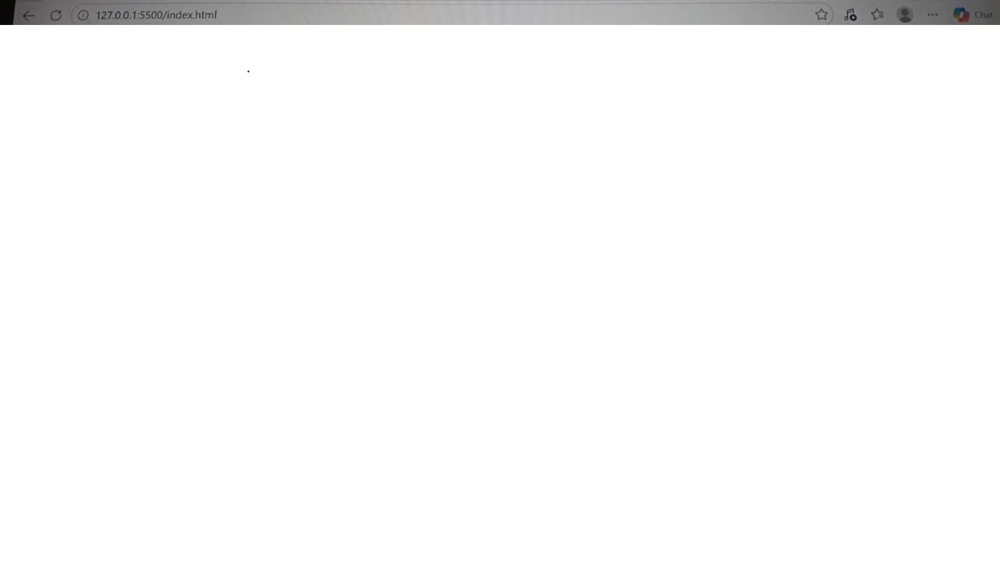

# Responsive Internship Board

A responsive internship listing website built using HTML, CSS, and JavaScript. Users can explore internship opportunities, search by role or company, and filter listings by domain.

## Features

- Responsive layout for mobile, tablet, and desktop
- Internship cards rendered dynamically using JavaScript
- Search by internship title, company, domain, location, and description
- Domain filter populated from the internship data
- Clear filters button
- Empty-results and error states
- Accessible form labels, keyboard focus indicators, and status announcements
- Fictional sample internship records stored in JSON

## Technologies Used

- HTML5
- CSS3
- JavaScript (ES6+)
- JSON
- Live Server
- Git and GitHub

## Project Structure

```text
Responsive-Internship-Board/
├── data/
│   └── internships.json
├── screenshots/
├── index.html
├── style.css
├── script.js
└── README.md
```

## Getting Started

### Prerequisites

- Visual Studio Code
- Live Server extension

### Run Locally

1. Clone or download this repository.
2. Open the project folder in VS Code.
3. Install the Live Server extension if needed.
4. Right-click `index.html`.
5. Select **Open with Live Server**.

The website should open in your browser.

## How to Use

1. Browse the available internship cards.
2. Enter a keyword in the search field.
3. Select a domain from the dropdown.
4. Use **Clear filters** to reset the search.
5. Resize the browser or use its device toolbar to test responsiveness.

## Screenshots

Add screenshots of the working website to the `screenshots/` directory.

Suggested screenshots:

- `desktop.png` — desktop layout
- `mobile.png` — mobile layout
- `search-filter.png` — working search and domain filter

Once the images have been added, display them below:

### Desktop View



### Mobile View


### Search and Filters


## Sample Data

The project uses fictional internship records in `data/internships.json`. Application URLs are placeholders and do not represent real job opportunities.

## Accessibility

The interface includes semantic HTML, associated form labels, visible keyboard focus, accessible status messages, and responsive layouts.

## Deployment

Deployment URL: Add your published website URL here.

## Author

Created as part of the EdVyro Full Stack Development internship task.
